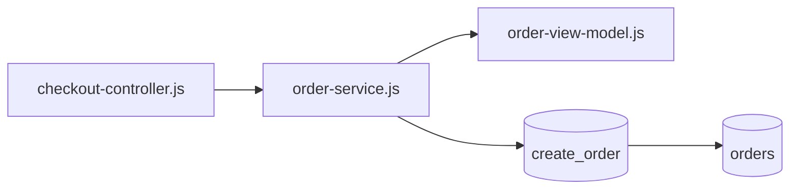

# Writing conventions for the vault

This file is the **constitution** of the vault. Whoever writes or changes a chapter, a person or an agent, Kipi included, must respect its rules. The rules derive from the project rules file (`CLAUDE.md` of the workspace) and from Kipi's workflows.

---

## 1. Always cite the source (no hallucinations)

**Absolute rule.** Every technical statement in a chapter must be traceable to a source file that was **actually read** in the session.

Standard citation formats:

- Single line: `src/checkout/checkout-controller.js:142`
- Line range: `src/checkout/checkout-controller.js:142-178`
- Inline in a paragraph: "…the method filters on `order_status` (see `src/orders/order-repository.js:142`)…"
<!-- onegate-if: multi-branch -->
- Citation of a file on a **different variant** from the file's own: `enterprise:packages/payments/src/adapter.js:142` (prefix `<BranchName>:`). In a file that does not declare a `variant` the variant of the file is the baseline.
- In **every file that declares a `variant`** (section 2.1), whether a variant file (section 3.2) or a base chapter captured on a variant that is not the baseline, the variant is the one declared in the frontmatter, at the capture commit or at the one a bridge box declares for part of the file: a citation without a prefix belongs to that variant. The prefix serves only to cite **another** variant, the baseline included.
<!-- onegate-endif -->

If you have not read the file, **you do not cite it**. If you are unsure, ask or read first. Never invent line numbers, method signatures or the structure of a table.

### 1.1 Attribution of non-code sources (people, channels, work items)

Provenance is not only about code files. **Every statement must declare where it comes from and in which channel**, because the channel changes its status:

| Channel | Status of the information | How to mark it |
|---|---|---|
| Text of the work item | requirement (but may contain ambiguity) | `(item 1234)` |
| Chat or message of a colleague | opinion, indication or caution: **to validate** | `(reviewer, chat, <date>)` |
| Email | written indication: to validate | `(project manager, email, <date>)` |
| Code read in the session | verified fact | `file.js:NN` |
| Query to an environment database | **measured fact, not re-verifiable from versioned files** | `(measured on the development environment, <date>)` |
| On-screen observation or test round | measured fact, reproducible only by redoing the round | `(round of <date>, report section N)` |
| My own deduction | hypothesis | `(inference, to be verified)` |

**Why the last three rows are separate from "code read in the session"**: a fact read in a versioned file can be rechecked by anyone, at any time, with no permissions and no cost. A count taken on an environment database cannot: it depends on that database and that day, and section 13 forbids reconnecting without an explicit request. Both are facts, neither hypotheses nor indications, but **the reader must be able to tell the ones they can recheck alone from the ones they must ask for**. A chapter that mixes them under the same citation form makes people believe re-verifiable what is not.

Practical rules for a fact measured on a database:

- Declare **environment and date** in the line itself, not only in the frontmatter.
- Say **who authorized** the connection, because section 13 makes it an exception, not the norm.
- Never promote it later to a source fact "because it is written by now": if it is needed as a source fact, look for it in source.
- If a versioned file says the same thing, **cite that** and use the measurement only as confirmation.

**Peremptory rule:** never promote to "requirement" what arrives from an informal channel (chat, email, voice) until it is confirmed. Always keep *who said it* distinct from *what the work item asks*.

**Who is who:** the channel is not enough to weigh the information, the **role** of who speaks matters too (reviewer, project manager, back-end developer). Chapters refer to people by **role label**, never by name; the declared roles are in `_meta/roles-and-sources.md` when the vault has it, and it is the only file where names may live. If a role label is not in that table, the role is not known and must be asked, not deduced.

> **Case on acme-shop:** a reviewer's **verbal caution** ("do not trigger the inventory lock") was treated as if it were a **requirement of the work item**. It was not: it was a colleague's warning to be verified in the code, and the verification then showed that no such "lock" exists as a gate. A mistake of source attribution: not to be repeated.

---

## 2. Standard frontmatter of the chapters

Every `.md` file in the vault (excluding `index.md` and `_meta/sources.md`) must have a YAML frontmatter:

<!-- onegate-if: multi-branch -->
```yaml
---
chapter_id: checkout/payment-adapters       # relative path without .md
variant_of: checkout/payment-adapters       # only in variant files (3.2): chapter_id of the base chapter
status: placeholder                         # placeholder | drafting | complete | stale
variant: community                          # exactly one per file (2.1); `none` if no source is in the code repository
branch_at_capture: community/develop        # git branch read at capture
commit_at_capture: <hash>                   # capture commit: bare hash, no prose next to it
hash_method: git-blob                       # the only method for new or recaptured files (2.1)
source_files:                               # paths from the root of the code repository
  - src/checkout/checkout-controller.js
  - src/orders/order-view-model.js
source_files_hashes:                        # git blob at the capture commit (tree id for a folder: 2.1), first 8 characters. Empty if status=placeholder
  src/checkout/checkout-controller.js: <blob8>
  src/orders/order-view-model.js: <blob8>
links_to:                                   # other relevant chapters or external docs
  - ./order-view-models.md
branches_covered:                           # which variants this chapter describes
  - community
  - enterprise                              # only if the "Variants" section is populated
last_updated: <YYYY-MM-DD>                  # ISO date
---
```
<!-- onegate-endif -->
<!-- onegate-if: single-branch -->
```yaml
---
chapter_id: checkout/payment-adapters       # relative path without .md
status: placeholder                         # placeholder | drafting | complete | stale
branch_at_capture: main                     # git branch read at capture
commit_at_capture: <hash>                   # capture commit: bare hash, no prose next to it
hash_method: git-blob                       # the only method for new or recaptured files (2.1)
source_files:                               # paths from the root of the code repository
  - src/checkout/checkout-controller.js
  - src/orders/order-view-model.js
source_files_hashes:                        # git blob at the capture commit (tree id for a folder: 2.1), first 8 characters. Empty if status=placeholder
  src/checkout/checkout-controller.js: <blob8>
  src/orders/order-view-model.js: <blob8>
links_to:                                   # other relevant chapters or external docs
  - ./order-view-models.md
last_updated: <YYYY-MM-DD>                  # ISO date
---
```
<!-- onegate-endif -->

Allowed statuses:

- `placeholder`: only the skeleton exists; no substantial content.
- `drafting`: being written, not ready for reuse.
- `complete`: all the content is cited and reviewed.
- `stale`: `source_files_hashes` no longer match the code; `[UK] Update Knowledge` is needed.

### 2.1 One file, one capture

The same path can be a different file on every branch family, so a hash only means something together with the branch and the commit it was taken on. Four rules follow.

<!-- onegate-if: multi-branch -->
1. **Every vault file belongs to a single variant**, declared in `variant`. The variant is the prefix of the git branch by the rule of the project, written with the canonical spelling of the table of known variants in `_meta/variants.md`. A file whose sources are all outside the code repository declares `variant: none`.
<!-- onegate-endif -->
<!-- onegate-if: single-branch -->
1. **Every vault file is captured on a single branch**, declared in `branch_at_capture`.
<!-- onegate-endif -->
2. **One capture per file.** All the hashes of a file are taken at the same commit, declared in `commit_at_capture` as a bare hash, with no prose; `branch_at_capture` says which git branch was read. A file with sources captured on different branches is a defect: it is split into variant files (3.2) where the project has variants. Hashes taken at different commits of the same branch are a capture to redo, all at the same commit.
3. **The hash is the git blob** of the source at the capture commit (the tree id for a folder: see the two cases below), first 8 characters, with `hash_method: git-blob`. It can be recomputed from any checkout, without switching branch. A source outside the code repository (the project rules file) takes the blob of the file as it is in the workspace and stays always evaluable; if the vault file cites a **past version** of that source, the hash is the blob of that version at a workspace commit, the commit is declared in the bridge box and the file turns out stale against today. The commands are in `{{KIPI_HOME}}/workflows/capture.md`.
4. **No prose in the frontmatter.** The frontmatter carries only the fields of the schema above. The history of the updates lives in `{{KIPI_STATE_DIR}}/uk-foldins.jsonl`. Notes in prose found in a frontmatter, when a chapter is split or recaptured, leave it and enter verbatim, in date order, in a final section `## Update history` of the file they refer to.

Two cases where the source is not a versioned file:

- **A folder.** A chapter that is an inventory by name (the procedures of a schema, the packages of a project, the scripts of a migration folder) has for source the folder whose content it affirms as a list or a count. In `source_files` it is written with the trailing `/`, and its hash is the **git tree id** at that commit, first 8 characters: it changes when a file of the folder changes, is added or removed. Without the folder no hash notices a procedure or a package that was added, because the inventory cites no lines of the files it lists. The folder does not replace files cited with a line, which stay sources of their own.
- **A file excluded from git** (a local editor settings file, a file of a downloaded package) has no blob at any commit and **is not a source**: it does not enter `source_files`. The text that describes it declares that it is an observation on a local copy, with the date it was made.

Files without `hash_method: git-blob` are valid until they are recaptured; for section 11 they are neither stale nor current, they are `not captured`.

---

## 3. Variants
<!-- onegate-if: multi-branch -->

This project keeps the same code in several long-lived branch families. See `_meta/variants.md` for the reasons and the table of known variants. Operational summary:

- The chapters of **cross-cutting** sections describe the version of the baseline variant (`{{BASELINE_VARIANT}}`) **first**.
- Every cross-cutting chapter **must** contain a final subsection `## Variants` with a table of this format:

  ```markdown
  ## Variants

  | Variant                  | Where the same concept lives                     | Relevant differences                        |
  |--------------------------|--------------------------------------------------|---------------------------------------------|
  | community (baseline)     | `src/payments/*.js`                              | none                                        |
  | enterprise               | `packages/payments/src/*.js`                     | Path moved; retry policy is configurable    |
  ```

- If a variant is **equal to the baseline**, write `(same as baseline)` instead of leaving it empty.
- If you have not verified a variant, **do not write "(same as baseline)"**: write `(not verified)` and add to `branches_covered` only the variants actually read.
- What is proper to a variant, with its sources, goes in the **variant file** of that variant (3.2) and the table links it, instead of describing it inline in the base chapter.

Chapters of **per-variant** sections (the ones that `index.md` marks so) do NOT have this subsection: they already describe one specific variant.

### 3.1 The `_summary.md` carry an **aggregated** view

The section indexes (`_summary.md` of the cross-cutting sections) also have the section `## Variants: overview of the section`. **It is not the same thing** as the table of a chapter:

- The table of a **chapter** says *how that concept is made* on each variant. It is the source.
- The table of a **`_summary.md`** says, for each variant, **how many and which chapters** of the section were verified on that variant and where to read. It is a **derived view**.

Three rules follow, and they exist because this choice deliberately introduces a duplication:

1. **When they disagree, the chapter wins.** The summary is looked at to know *where* to search, never to know *how it is made*. Every summary table carries this warning at its head.
2. **A `(not verified)` variant in a summary means "no chapter of the section was ever read on that variant"**, not "it is equal to the baseline". Section 3 applies: `(same as baseline)` is not written for a variant that was not read.
3. **Consistency between summary and chapters is a check of `[CL]`**, not an acquired fact. A chapter that adds a variant to its own `branches_covered` without updating the summary of its section creates a divergence that no automatic hash check can see, because hashes look at the code and not at the internal coherence of the vault.

### 3.2 Base chapter and variant file

A chapter that describes more than one variant does not carry everything in one file: every file has a single capture (2.1).

- **The base chapter** (name without suffix) tells the common story and is captured on a single variant, normally the baseline. The `## Variants` table stays, with a row per variant: a sentence of summary and the link to the variant file when it exists.
- **The variant file** is named `<chapter>.<slug>.md` and sits next to the base chapter (example: `checkout/payment-retry.enterprise.md`). The slug is the one of the "Slug" column of the table of known variants in `_meta/variants.md`. The file declares `variant_of: <chapter_id of the base>` and contains only what is proper to that variant, with its sources, its hashes and its capture. An opening line points back to the base chapter and says in what the variant diverges; the common story is not repeated.
- If the base chapter is not captured on the baseline, the baseline can have its own variant file too.
- **`branches_covered`**: the base chapter lists all the verified variants of its `## Variants` table, that is, those the base and its variant files cover together; a variant file lists only its own variant. A row of the table is **verified** if it reports code read or a measurement; it is not if it carries `(not verified)` or is written as a hypothesis ("probably", "check whether"). The variants of examples read inside a rule that holds for all variants, and those of notes read on a variant and left in the base, also count.
- **One variant file per variant**, even when the variant has more working branches that are read separately. The part read on a second working branch declares its own branch and commit in the bridge box of the file, and its sources have no hash until the recapture on the reference branch of the variant. Example: `checkout/payment-retry.enterprise.md`, captured on `enterprise/1234-payment-retry`, with one section read on `enterprise/1240-refund-flow`.
- A fact read on a variant is written in the file of that variant. It is never written in the file of another variant with a note "hashes not touched": it is the defect that variant files exist to remove.
- **`index.md` lists only base chapters.** A variant file is not an orphan if its base chapter links it from the variants table.
<!-- onegate-endif -->
<!-- onegate-if: single-branch -->

This project keeps its code in one branch family: there are no variants, no variant files and no `## Variants` table. Every chapter is captured on one branch (section 2.1) and is evaluated against the default branch of the code repository (section 11). If the project later grows long-lived branch families, ask the human to run the install again with the multi-branch answer: variant files and their rules are part of that answer.
<!-- onegate-endif -->

---

## 4. Sensitive data: NOTHING in the vault

The vault inherits the sensitive-data rule of the project rules file. No real value, no secret. Placeholders only:

| Datum | Placeholder |
|---|---|
| Server IP address | `<SERVER_IP>` |
| Database server or instance | `<DB_SERVER>` |
| Database user | `<DB_USER>` |
| Database password | `<DB_PASSWORD>` |
| JWT secret | `<JWT_SECRET_KEY>` |
| API key | `<API_KEY>` |
| License key | `<LICENSE_KEY>` |
| Real customer or user code | `<CUSTOMER_CODE>` |

Complete connection strings and credentials are **never** written here, not even as examples. If an example is needed, use placeholders: `Data Source=<DB_SERVER>;User=<DB_USER>;Password=<DB_PASSWORD>`.

---

## 5. Links between chapters

- **The outgoing link is mandatory when it is useful.** If a chapter leans on another one to avoid repeating it, that pointer is declared in `links_to` and cited in the text. An implicit pointer does not exist.
- **The return link is optional.** Add it when it really helps the reader of the destination chapter, that is, when the pointer is useful from there too. Do not add it for symmetry: it is a mechanical write that nobody reads and that ages by itself. The audit does not check asymmetries.
- Links to files outside the vault (project digests, the project rules file) are **outgoing only**: Kipi does not modify those files.
- Relative links are **from the folder of the current file** (for example, from `checkout/payment-adapters.md` to `../orders/_summary.md`).
- A `links_to` that points to a **nonexistent** file is a defect, and that one does get fixed.

---

## 6. Code excerpts

When you insert a block of code:

- At most **30 lines**. If you need more, cut with `// ... (omitted) ...` and cite the range `:142-178, :220-245`.
- Always with the language specified (`javascript`, `sql`, `xml`, `bash`).
- Always preceded by a source citation: **`src/checkout/checkout-controller.js:142-178`** then the code block.

---

## 7. Mermaid for relations among 3 or more entities

If you describe a data flow, a dependency or a sequence among 3 or more entities (files, classes, tables, systems), prefer a Mermaid diagram to text. Example:



For 2 entities or fewer, a sentence of prose is better.

---

## 8. Language

The vault is written in {{DOCUMENT_LANGUAGE}}. Code identifiers, table names, column names and file names keep the **original language of the code**: do not translate `OrderService` into the document language.

---

## 9. Windows reserved names

Never create files named `nul`, `con`, `prn`, `aux`, `com1` to `com9`, `lpt1` to `lpt9`. If a chapter must refer to a device, writing its name in the text is fine; do not create a file with that name.

---

## 10. When a chapter grows too much

Indicative threshold: **600 lines or more**, or **15 subsections or more**. When you pass it:

1. Identify a cohesive sub-area.
2. Create a new chapter next to the old one.
3. Replace the subsection with an outgoing link and 1 paragraph of summary.
4. Update `index.md` and the `links_to` of the two chapters.

---

## 11. Update Knowledge `[UK]`: when a file becomes stale

Staleness is evaluated **file by file**, by git ref, without switching branch in the code repository. **The outcome does not depend on the checked-out branch.** There are two references:

<!-- onegate-if: multi-branch -->
- the **reference branch** of the file's variant (the "Reference branch" column of the table of known variants in `_meta/variants.md`);
<!-- onegate-endif -->
<!-- onegate-if: single-branch -->
- the **default branch** of the code repository (`origin/HEAD`);
<!-- onegate-endif -->
- the **tip of the capture branch**, the branch declared in `branch_at_capture`, if it still exists (`origin/<branch>`, otherwise the local branch).

For every source the blob (the tree, for a folder) read on the reference is compared with the declared hash. The file is:

- **current** if all its hashes match on the first reference;
- **current on task branch** if they diverge on the first reference but all match on the tip of the capture branch: it describes the code of a task not yet merged. It is declared so, with the branch name, and `status` stays `complete`; when the task enters the reference branch the file must be re-evaluated;
- **stale** if at least one hash diverges on both references, or on the first when the capture branch no longer exists.

There is no "not evaluable because the checkout is on another branch". Only a file with no capture (`not captured`) and a reference branch missing locally are not evaluable.

Whoever evaluates always declares **on which reference and at which commit**: a local reference branch can be weeks behind the remote.

When a file is stale, `[UK]` reads the diff between the capture commit and the reference, updates the text, recaptures **all** the hashes of the file at the new commit and reports. It does not ask for approval before writing: the review happens afterwards, on the git diff, which stays uncommitted until the human gives the OK to commit. Never silent modifications: every application has its report and its line in `{{KIPI_STATE_DIR}}/uk-foldins.jsonl`.

> Case on acme-shop: `checkout/payment-retry.md` was captured on the unmerged branch `community/1234-payment-retry` at `<hash>`; it was `current on task branch` until the branch entered `community/develop`. When another session moved the checkout to the other edition, a rule based on `HEAD` had marked it stale for no reason in the code. Commands, outcomes and how to tell that a task branch is merged when pull requests enter as squash: `{{KIPI_HOME}}/workflows/capture.md` section 3.

---

## 12. Log of communication with colleagues

The relevant communications with colleagues (chat, email, messages on a work item) **are logged** in the relevant chapter or session note, not left only in the chat. They serve to rebuild *when* and *on which basis* a decision was taken.

Format of the log line:

```markdown
> **Log - <YYYY-MM-DD HH:MM>:** <sender or recipient role label>, <channel>. <summary of the content>. **State:** <awaiting answer | confirmed | superseded>.
```

Example on acme-shop:

```markdown
> **Log - <YYYY-MM-DD HH:MM>:** message sent to the reviewer (chat). Summary of the approach
> (an `if` before `createRefundRequest`) and outcome of the code check (no lock tied to refunds).
> Question: what is meant by "consequences on the fulfilment flow"?
> **State:** awaiting answer.
```

Rules:

- Always with **date and time**, sender or recipient role label, channel.
- A summary of the content, not the full copy-paste (unless the exact text matters).
- State the **state** (awaiting / confirmed / superseded) and update it when the answer comes instead of deleting the line: the history stays.
- When an answer **confirms or denies** a piece of information previously marked "to validate" (1.1), update the status of that information accordingly.

---

## 13. Operational safety: database connection and real customer data

Operational rule for Kipi and for any agent or session working on the project:

- **No connection to a real database without an explicit request.** On acme-shop an agent connected to the database **by itself** after reading the connection string from the project's configuration files. The credentials in the configs are reachable by the tool: **assume it can find and use them**, and check the reachable perimeter before letting it operate.
- **A dedicated read-only user** for experiments that touch the database (do not use the application's credentials from the configs).
- **Never let the AI process real customer data.** Real data stays in the customer systems, locked down; experiments work only on **synthetic data**.
- Writes to shared data are approved by {{DATA_APPROVER}}, one by one.

---

## 14. Where knowledge lives: vault vs agent memory

The **auto-memory of the agent** (outside the repository, not versioned, not shared with the team) and the **vault** (versioned on git, shared) have distinct roles. Every piece of information has **one home**: do not duplicate.

| Type of information | Home |
|---|---|
| Domain knowledge, architecture, code patterns | **vault** |
| Decisions (technical or from code review) and their rationale | **vault** (the relevant chapter or a decision record) |
| State or outcome of a task (implemented, closed, open) | **vault** (log of the chapter, section 12) |
| Behavioural feedback on how the agent must work | memory (`type: feedback`) |
| Preferences and identity of the user | memory (`type: user`) |
| Operational how-tos of the environment that cannot be versioned | memory, or `_meta/env-troubleshooting-log.md` when the vault has it |

**Rule:** versionable and shareable content (knowledge, decisions, task state) goes **only in the vault**. The memory must not copy its volatile detail (commits, `file:line`, column numbers, state): otherwise a change must be made in two places and the copies diverge. It has happened: on acme-shop the vault recommended making a test helper `internal`, while the revised decision, "make it `public`", lived only in the memory.

If something that is knowledge, a decision or task state emerges in the memory, **bring it into the vault** and remove the detail from the memory (leave at most a short pointer). No `file:line`, commit or task state in memory if the fact is already (or must be) in the vault.

---

## 15. Tooling trap: `Edit replace_all` on a self-referencing pattern

When the `old_string` of an `Edit` with `replace_all` appears **both at the call sites and in the definition** of the function that calls it (for example renaming `foo()` to `safeFoo()` where `safeFoo` calls `foo()` internally), `replace_all` breaks the definition and creates infinite recursion.

Mitigation:

1. Check the occurrences with `Grep` **before** the `replace_all`.
2. If the definition is among the matches, use pointed `Edit`s instead of `replace_all`, or fix the definition with a second targeted `Edit` right after.

It holds for any agent that edits code in this workspace, not only for Kipi.

---

## 16. Every test round produces its own report file

**A test round is not finished until its report file exists.** The file is created in the artifacts folder of the project (`{{ARTIFACTS_DIR}}/<YYYY-MM>/`) with the name `report-cases-<task>-<topic>.md`, **opened at the first results** and updated case by case while the round proceeds.

It is not asked or confirmed each time: it is part of the round, as the round is part of the task. Whoever runs a test round opens it on their own initiative.

What goes in it, for each case executed: environment (branch, commit, account or tenant, user, build read on screen), the IDs of the records used with their dates, what was observed, the names of the files produced, and every deviation from the expected, however small. Names and personal details of the subjects do **not** go in: only IDs (section 4).

Two reasons, both already paid for:

1. **If the session is interrupted midway, the evidence cannot be rebuilt from memory.** Only the files on disk remain, and nothing else.
2. **A report written afterwards can conclude the opposite of the truth.** On acme-shop a report written after the round concluded that a saved delivery address "does not persist"; it was false, and the correction needed a second round and a rewrite of the file.
